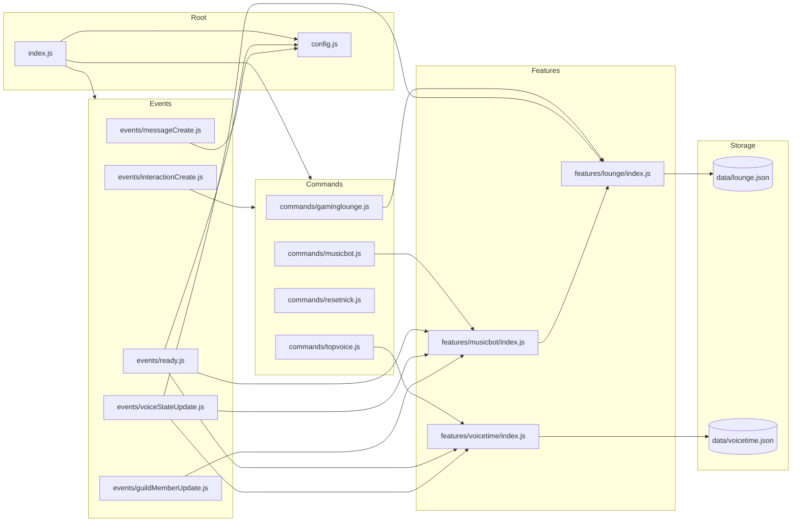

# 🏗️ Arsitektur Aplikasi ChihiroBot

_Terakhir diperbarui: 2026-10-18_
> Perbarui dokumen ini saat mengubah fitur terkait.

Dokumen ini menjelaskan struktur arsitektur modular ChihiroBot, peta dependensi antar modul, pemetaan event/command ke fungsi penangan (handler), serta model persistensi data.

---

## 📁 Pohon Struktur Direktori

```text
D:\Game\Bot\ChihiroBot\
├── .env.example                     # Template konfigurasi environment variables
├── package.json                     # Konfigurasi dependensi npm dan script eksekusi
├── package-lock.json                # Pengunci versi paket dependensi npm
├── config.js                        # Konfigurasi global aplikasi & satu-satunya pembaca process.env
├── index.js                         # Entry point: inisialisasi Discord Client, loader commands & events
├── commands/                        # Folder HANYA berisi definisi slash command (data + execute)
│   ├── gaminglounge.js              # Slash command /gaminglounge (setup, daftar, kategori, game)
│   ├── musicbot.js                  # Slash command /musicbot (role, setup)
│   ├── resetnick.js                 # Slash command /resetnick (reset nama non-bot massal)
│   └── topvoice.js                  # Slash command /topvoice (setup, filter kategori, filter kecuali)
├── events/                          # Folder HANYA berisi listener event Discord (name + execute)
│   ├── ready.js                     # Listener ClientReady: registrasi global commands, sync awal, status
│   ├── interactionCreate.js         # Listener InteractionCreate: router autocomplete, command, select menu
│   ├── messageCreate.js             # Listener MessageCreate: deteksi dan balasan mention bot
│   ├── voiceStateUpdate.js          # Listener VoiceStateUpdate: pemicu Top Voice, Lounge, & Music Bot
│   └── guildMemberUpdate.js         # Listener GuildMemberUpdate: pemicu refresh bot musik saat role/nama berubah
├── features/                        # Folder modular logika bisnis (satu subfolder per fitur)
│   ├── lounge/                      # Fitur Gaming Lounge (pembuatan room dinamis & cleanup room kosong)
│   │   ├── config.js                # Konfigurasi lokal Gaming Lounge & batas teknis Discord
│   │   ├── games.js                 # Data seed kategori & game default saat pertama kali bot menyala
│   │   ├── store.js                 # Pengelola persistensi data lounge.json
│   │   ├── rooms.js                 # Manajemen timer hitung mundur & auto-cleanup room kosong
│   │   ├── panel.js                 # Pembuat komponen ActionRow StringSelectMenu & refresh panel
│   │   ├── handlers.js              # Penangan pembuatan room, autocomplete, dan subcommand lounge
│   │   ├── index.js                 # Pintu masuk publik (public API) fitur Gaming Lounge
│   │   └── README.md                # Dokumentasi mandiri fitur Gaming Lounge
│   ├── musicbot/                    # Fitur Music Bot Panel (pemantau ketersediaan bot pemutar musik)
│   │   ├── config.js                # Konfigurasi lokal ikon bot musik & durasi debounce
│   │   ├── store.js                 # Akses penyimpanan ID role dan koordinat panel musik
│   │   ├── panel.js                 # Pembuat embed status bot musik & scheduling debounce
│   │   ├── handlers.js              # Penangan event perpindahan voice bot musik & eksekusi command
│   │   ├── index.js                 # Pintu masuk publik (public API) fitur Music Bot
│   │   └── README.md                # Dokumentasi mandiri fitur Music Bot
│   └── voicetime/                   # Fitur Top Voice (pelacakan jam aktif voice channel)
│       ├── config.js                # Konfigurasi lokal interval tick, refresh panel, & ikon medali
│       ├── store.js                 # Pengelola persistensi data voicetime.json
│       ├── helpers.js               # Fungsi utilitas format waktu & kriteria kelayakan channel
│       ├── panel.js                 # Pembuat embed leaderboard Top 10 & refresh pesan Discord
│       ├── tracker.js               # Pelacak sesi durasi aktif di memori, sync berkala, & graceful shutdown
│       ├── handlers.js              # Penangan eksekusi command /topvoice & helper opsi channel
│       ├── index.js                 # Pintu masuk publik (public API) fitur Top Voice
│       └── README.md                # Dokumentasi mandiri fitur Top Voice
├── data/                            # File penyimpanan data runtime dalam format JSON
│   ├── lounge.json                  # Database game, kategori, panel lounge, dan konfigurasi bot musik
│   └── voicetime.json               # Database akumulasi detik per channel, panel, kategori, & pengecualian
└── docs/                            # Dokumentasi teknis proyek
    ├── ARCHITECTURE.md              # Struktur arsitektur, dependensi modul, tabel router, & tabel data
    ├── CONFIG.md                    # Dokumentasi lengkap variabel .env dan batasan Discord API
    ├── DEVELOPMENT.md               # Panduan pengembangan langkah demi langkah
    ├── FLOWS.md                     # Diagram dan urutan alur proses (startup, lounge, voice, dll.)
    └── REVIEW.md                    # Laporan audit teknis dan daftar temuan untuk iterasi lanjutan
```

---

## 🧩 Diagram Dependensi Antar Modul

### Diagram Mermaid (Visual)


### Versi Teks ASCII (Cadangan)
```text
[index.js] ──> [config.js] (.env)
    │
    ├──> [commands/gaminglounge.js] ───────> [features/lounge/index.js] ────> [data/lounge.json]
    │                                                    ▲
    ├──> [commands/musicbot.js] ───────────> [features/musicbot/index.js] ────┘
    │
    ├──> [commands/topvoice.js] ───────────> [features/voicetime/index.js] ──> [data/voicetime.json]
    │
    ├──> [commands/resetnick.js] (Mandiri)
    │
    ├──> [events/ready.js] ─────────────────> [features/musicbot], [features/voicetime]
    ├──> [events/interactionCreate.js] ────> [commands/*] (Router)
    ├──> [events/messageCreate.js] ────────> [config.js]
    ├──> [events/voiceStateUpdate.js] ─────> [features/lounge], [features/musicbot], [features/voicetime]
    └──> [events/guildMemberUpdate.js] ────> [features/musicbot]
```

---

## 🗂️ Tabel: Event / Command ke Handler

Tabel ini memetakan setiap trigger Discord ke modul command/event dan fungsi API fitur yang dieksekusi:

| Pemicu (Trigger) | Jenis | File Definisi | Handler / Fungsi Fitur yang Dipanggil |
|---|---|---|---|
| `/gaminglounge setup` | Slash Command | [`commands/gaminglounge.js`](file:///D:/Game/Bot/ChihiroBot/commands/gaminglounge.js) | `lounge.handleSetup(interaction)` |
| `/gaminglounge daftar` | Slash Command | [`commands/gaminglounge.js`](file:///D:/Game/Bot/ChihiroBot/commands/gaminglounge.js) | `lounge.handleDaftar(interaction)` |
| `/gaminglounge kategori ...` | Slash Command | [`commands/gaminglounge.js`](file:///D:/Game/Bot/ChihiroBot/commands/gaminglounge.js) | `lounge.handleCategoryGroup(interaction, sub)` |
| `/gaminglounge game ...` | Slash Command | [`commands/gaminglounge.js`](file:///D:/Game/Bot/ChihiroBot/commands/gaminglounge.js) | `lounge.handleGameGroup(interaction, sub)` |
| Autocomplete kategori / game | Autocomplete | [`commands/gaminglounge.js`](file:///D:/Game/Bot/ChihiroBot/commands/gaminglounge.js) | `lounge.handleAutocomplete(interaction)` |
| Select Menu `gaming:<key>` | Komponen Pesan | [`events/interactionCreate.js`](file:///D:/Game/Bot/ChihiroBot/events/interactionCreate.js) | `commands.get('gaminglounge').handleSelect(interaction)` -> `lounge.handleSelect(interaction)` |
| `/musicbot role` | Slash Command | [`commands/musicbot.js`](file:///D:/Game/Bot/ChihiroBot/commands/musicbot.js) | `musicbot.handleRoleCommand(interaction)` |
| `/musicbot setup` | Slash Command | [`commands/musicbot.js`](file:///D:/Game/Bot/ChihiroBot/commands/musicbot.js) | `musicbot.handleSetupCommand(interaction)` |
| `/topvoice setup` | Slash Command | [`commands/topvoice.js`](file:///D:/Game/Bot/ChihiroBot/commands/topvoice.js) | `voicetime.handleSetup(interaction)` |
| `/topvoice kategori ...` | Slash Command | [`commands/topvoice.js`](file:///D:/Game/Bot/ChihiroBot/commands/topvoice.js) | `voicetime.handleCategoryGroup(interaction, sub)` |
| `/topvoice kecuali ...` | Slash Command | [`commands/topvoice.js`](file:///D:/Game/Bot/ChihiroBot/commands/topvoice.js) | `voicetime.handleExcludedGroup(interaction, sub)` |
| `/resetnick` | Slash Command | [`commands/resetnick.js`](file:///D:/Game/Bot/ChihiroBot/commands/resetnick.js) | `execute(interaction)` (Logika reset bertahap mandiri) |
| `ClientReady` | Gateway Event | [`events/ready.js`](file:///D:/Game/Bot/ChihiroBot/events/ready.js) | `musicbot.refresh(client, guild.id)`, `voicetime.start(client)` |
| `InteractionCreate` | Gateway Event | [`events/interactionCreate.js`](file:///D:/Game/Bot/ChihiroBot/events/interactionCreate.js) | Router delegasi ke `command.execute`, `command.autocomplete`, atau `handleSelect` |
| `MessageCreate` | Gateway Event | [`events/messageCreate.js`](file:///D:/Game/Bot/ChihiroBot/events/messageCreate.js) | Deteksi mention langsung bot -> kirim balasan sapaan |
| `VoiceStateUpdate` | Gateway Event | [`events/voiceStateUpdate.js`](file:///D:/Game/Bot/ChihiroBot/events/voiceStateUpdate.js) | `voicetime.onUpdate(oldState, newState)`, `lounge.checkRoom(client, channel)`, `musicbot.handleVoiceStateUpdate(oldState, newState)` |
| `GuildMemberUpdate` | Gateway Event | [`events/guildMemberUpdate.js`](file:///D:/Game/Bot/ChihiroBot/events/guildMemberUpdate.js) | `musicbot.handleGuildMemberUpdate(oldMember, newMember)` |

---

## 💾 Tabel Data Persisten

Tabel ini menjelaskan struktur berkas database JSON pada folder `data/`:

| File | Struktur Utama | Modul Pembaca (Read) | Modul Penulis (Write) | Deskripsi Isi |
|---|---|---|---|---|
| [`data/lounge.json`](file:///D:/Game/Bot/ChihiroBot/data/lounge.json) | `{ roomPrefix: string, categories: { [slug]: { label, games } }, panels: { [guildId]: { channelId, messageId } }, musicRoles: { [guildId]: roleId }, musicPanels: { [guildId]: { channelId, messageId } } }` | [`features/lounge/store.js`](file:///D:/Game/Bot/ChihiroBot/features/lounge/store.js), [`features/musicbot/store.js`](file:///D:/Game/Bot/ChihiroBot/features/musicbot/store.js) | [`features/lounge/store.js`](file:///D:/Game/Bot/ChihiroBot/features/lounge/store.js) (`save()`), [`features/musicbot/store.js`](file:///D:/Game/Bot/ChihiroBot/features/musicbot/store.js) (`setRole()`, `setPanel()`) | Menyimpan data menu dropdown Game Lounge (kategori, daftar game, emoji, batas user), koordinat panel lounge, role bot musik, dan koordinat panel embed bot musik. |
| [`data/voicetime.json`](file:///D:/Game/Bot/ChihiroBot/data/voicetime.json) | `{ channels: { [guildId]: { [channelId]: number } }, panels: { [guildId]: { channelId, messageId } }, categories: { [guildId]: string[] }, excluded: { [guildId]: string[] }, totals?: object }` | [`features/voicetime/store.js`](file:///D:/Game/Bot/ChihiroBot/features/voicetime/store.js) | [`features/voicetime/store.js`](file:///D:/Game/Bot/ChihiroBot/features/voicetime/store.js) (`save()`), [`features/voicetime/tracker.js`](file:///D:/Game/Bot/ChihiroBot/features/voicetime/tracker.js) (sinkronisasi berkala) | Menyimpan total durasi aktif (dalam detik) per channel voice, koordinat pesan panel leaderboard, daftar ID kategori yang dihitung, dan daftar ID channel yang dikecualikan. |
