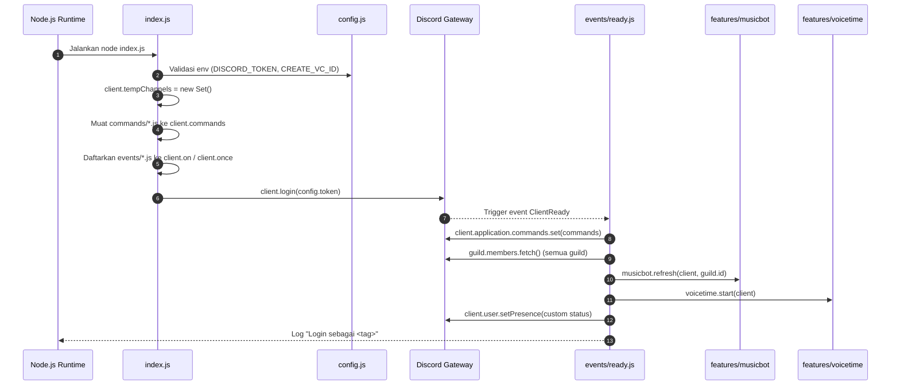
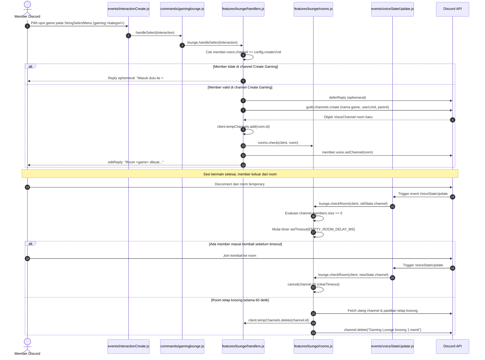
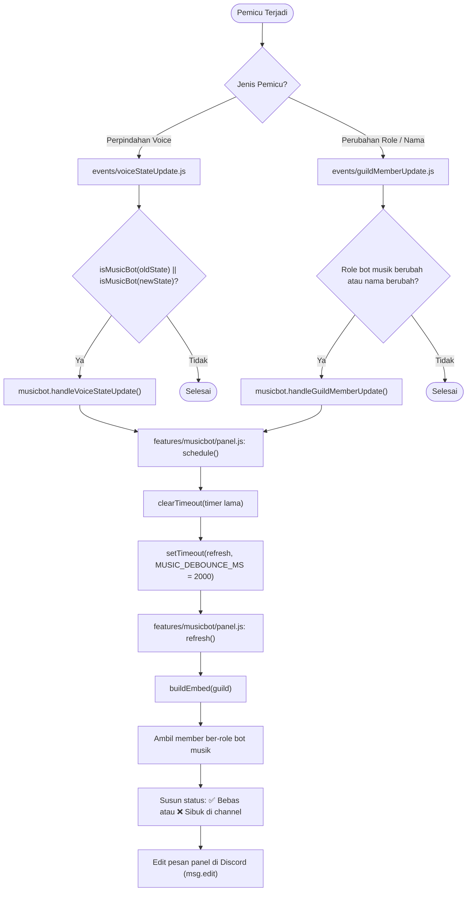
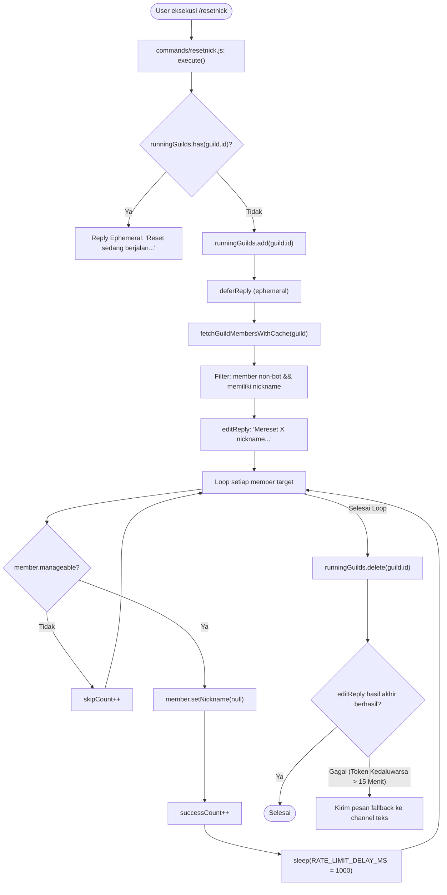

# 🔄 Alur Kerja Sistem (System Flows)

_Terakhir diperbarui: 2026-10-18_
> Perbarui dokumen ini saat mengubah fitur terkait.

Dokumen ini mendokumentasikan alur eksekusi setiap proses utama di ChihiroBot menggunakan diagram alur (Mermaid) dan langkah-langkah bernomor yang menyebutkan nama berkas dan fungsi secara presisi.

---

## 1. Alur Startup Bot (Inisialisasi hingga Siap)

Proses dari saat aplikasi dijalankan (`npm start`) hingga bot online dan siap menerima interaksi di Discord.

### Diagram Alur


### Langkah-langkah Proses
1. [`index.js`](file:///D:/Game/Bot/ChihiroBot/index.js): Mengimpor [`config.js`](file:///D:/Game/Bot/ChihiroBot/config.js) yang memvalidasi keberadaan `DISCORD_TOKEN` dan `CREATE_VC_ID` di file `.env`. Jika variabel wajib hilang, proses berhenti dengan kode keluar 1.
2. [`index.js`](file:///D:/Game/Bot/ChihiroBot/index.js): Menginisialisasi `client.commands = new Collection()` dan `client.tempChannels = new Set()`.
3. [`index.js`](file:///D:/Game/Bot/ChihiroBot/index.js): Membaca direktori `commands/` secara otomatis, memuat seluruh file command, dan menyimpannya ke koleksi.
4. [`index.js`](file:///D:/Game/Bot/ChihiroBot/index.js): Membaca direktori `events/` secara otomatis dan mendaftarkan listener `client.once` atau `client.on`.
5. [`index.js`](file:///D:/Game/Bot/ChihiroBot/index.js): Menghubungkan bot ke Discord Gateway melalui `client.login(config.token)`.
6. [`events/ready.js`](file:///D:/Game/Bot/ChihiroBot/events/ready.js) (`execute`): Mendaftarkan seluruh definisi slash command ke API Discord secara global melalui `client.application.commands.set()`.
7. [`events/ready.js`](file:///D:/Game/Bot/ChihiroBot/events/ready.js): Menjalankan `guild.members.fetch()` untuk memastikan cache member server terisi (dibutuhkan untuk mendeteksi member bot musik).
8. [`events/ready.js`](file:///D:/Game/Bot/ChihiroBot/events/ready.js): Memanggil `musicbot.refresh(client, guild.id)` pada [`features/musicbot/panel.js`](file:///D:/Game/Bot/ChihiroBot/features/musicbot/panel.js) untuk memperbarui tampilan embed panel musik yang tersimpan.
9. [`events/ready.js`](file:///D:/Game/Bot/ChihiroBot/events/ready.js): Memanggil `voicetime.start(client)` pada [`features/voicetime/tracker.js`](file:///D:/Game/Bot/ChihiroBot/features/voicetime/tracker.js) untuk menyinkronkan status awal seluruh channel voice dan menyalakan loop interval pelacak.
10. [`events/ready.js`](file:///D:/Game/Bot/ChihiroBot/events/ready.js): Memasang status bot (idle) dengan teks custom dari `config.botStatusText` via `client.user.setPresence()`.

---

## 2. Alur Gaming Lounge (Pembuatan Room & Auto-Cleanup)

Proses ketika member memilih game dari dropdown menu hingga room dihapus setelah kosong.

### Diagram Alur


### Langkah-langkah Proses
1. [`events/interactionCreate.js`](file:///D:/Game/Bot/ChihiroBot/events/interactionCreate.js): Menangkap interaksi select menu dengan ID berawalan `gaming:`, lalu meneruskannya ke `commands.get('gaminglounge').handleSelect(interaction)`.
2. [`commands/gaminglounge.js`](file:///D:/Game/Bot/ChihiroBot/commands/gaminglounge.js): Mendelegasikan eksekusi ke `lounge.handleSelect(interaction)` di [`features/lounge/handlers.js`](file:///D:/Game/Bot/ChihiroBot/features/lounge/handlers.js).
3. [`features/lounge/handlers.js`](file:///D:/Game/Bot/ChihiroBot/features/lounge/handlers.js) (`handleSelect`):
   - Mereset komponen menu di pesan panel menggunakan `panel.buildMenus()`.
   - Mengambil data game dari `store.data.categories[key]`.
   - Memeriksa apakah pengguna berada di voice channel dengan ID `config.createVcId`. Jika tidak, kirim peringatan ephemeral.
   - Mengirim `deferReply` ephemeral.
   - Membuat channel voice baru via `interaction.guild.channels.create()` dengan nama prefix game, kategori induk yang sama, dan batas jumlah user (`userLimit`).
   - Mendaftarkan ID room baru ke `interaction.client.tempChannels`.
   - Memindahkan member ke room baru via `member.voice.setChannel(room)`.
4. [`events/voiceStateUpdate.js`](file:///D:/Game/Bot/ChihiroBot/events/voiceStateUpdate.js): Saat member keluar dari voice channel, memanggil `lounge.checkRoom(client, oldState.channel)`.
5. [`features/lounge/rooms.js`](file:///D:/Game/Bot/ChihiroBot/features/lounge/rooms.js) (`check`):
   - Memeriksa apakah channel ada di `client.tempChannels`.
   - Jika channel masih memiliki orang, panggil `cancel(channel.id)` untuk membatalkan timer yang sedang berjalan.
   - Jika kosong dan belum ada timer yang aktif, buat `setTimeout` selama `EMPTY_ROOM_DELAY_MS` (60 detik).
   - Saat timer selesai, fetch ulang channel untuk memverifikasi. Jika tetap kosong, hapus ID dari `client.tempChannels` dan hapus channel via `ch.delete()`.

---

## 3. Alur Music Bot Panel (Live Status & Debounced Update)

Proses pemantauan status bot musik saat berpindah voice channel atau saat terjadi perubahan role member.

### Diagram Alur


### Langkah-langkah Proses
1. **Pemicu Voice**: Member berpindah, join, atau disconnect dari voice channel memicu [`events/voiceStateUpdate.js`](file:///D:/Game/Bot/ChihiroBot/events/voiceStateUpdate.js).
   - Memeriksa apakah member memiliki role bot musik via `musicbot.isMusicBot()`.
   - Jika ya dan channel berubah, memanggil `musicbot.handleVoiceStateUpdate()`.
2. **Pemicu Member**: Perubahan role atau pergantian nama member memicu [`events/guildMemberUpdate.js`](file:///D:/Game/Bot/ChihiroBot/events/guildMemberUpdate.js).
   - Memeriksa apakah role bot musik ditambahkan/dihapus atau nama bot diubah.
   - Jika ya, memanggil `musicbot.handleGuildMemberUpdate()`.
3. **Debounce Scheduling**: Kedua penangan di atas memanggil `schedule(client, guildId)` di [`features/musicbot/panel.js`](file:///D:/Game/Bot/ChihiroBot/features/musicbot/panel.js).
   - Timer sebelumnya dibatalkan (`clearTimeout`).
   - Timer baru dipasang selama 2000 ms (`MUSIC_DEBOUNCE_MS`) agar rentetan perpindahan cepat hanya menghasilkan 1 kali edit pesan.
4. **Pembaruan Panel**: Setelah timer berakhir, fungsi `refresh()` dijalankan:
   - Mengambil koordinat channel & message dari store.
   - Memanggil `buildEmbed(guild)` yang memetakan setiap bot dengan ikon bebas (`MUSIC_ICON_FREE`) atau sibuk (`MUSIC_ICON_BUSY`) beserta link channel voice tempatnya berada.
   - Mengedit pesan panel Discord (`msg.edit({ embeds: [embed] })`).

---

## 4. Alur Top Voice (Pelacakan Sesi & Pembaruan Leaderboard)

Proses penghitungan akumulasi durasi voice channel aktif dan penyimpanan berkala ke disk.

### Diagram Alur
```mermaid
flowchart TD
    subgraph Pelacakan Realtime
        A["events/voiceStateUpdate.js"] --> B["voicetime.onUpdate(oldState, newState)"]
        B --> C["features/voicetime/tracker.js: syncChannel()"]
        C --> D{"isTrackable(ch) && countHumans(ch) > 0?"}
        D -- "Ya (Aktif & Belum Ada Sesi)" --> E["activeSessions.set(key, now)"]
        D -- "Tidak (Kosong & Ada Sesi)" --> F["flushSession(key, now, false)"]
        F --> G["Tambah durasi detik ke store.data.channels"]
        G --> H["store.markDirty()"]
    end

    subgraph Interval 1 Menit (VOICE_TICK_MS)
        I([Tick Interval]) --> J["resyncGuild(guild)"]
        J --> K["flushSession(key, now, keep=true)"]
        K --> L{"store.getDirtyStatus()?"}
        L -- Ya --> M["store.save() (tulis ke data/voicetime.json)"]
        L -- Tidak --> N([Lewati Simpan])
    end

    subgraph Interval 5 Menit (TOP_VOICE_REFRESH_MS)
        O([Refresh Interval]) --> P["features/voicetime/panel.js: refresh()"]
        P --> Q["buildEmbed(guild)"]
        Q --> R["Saring channel: durasi >= 60 detik & isTrackable"]
        R --> S["Urutkan descending & ambil Top 10"]
        S --> T["msg.edit(embed leaderboard)"]
    end
```

### Langkah-langkah Proses
1. **Deteksi Aktivitas**: [`events/voiceStateUpdate.js`](file:///D:/Game/Bot/ChihiroBot/events/voiceStateUpdate.js) memanggil `voicetime.onUpdate()` di [`features/voicetime/tracker.js`](file:///D:/Game/Bot/ChihiroBot/features/voicetime/tracker.js).
2. **Evaluasi Kelayakan (`syncChannel`)**:
   - Mengecek apakah channel memenuhi kriteria `isTrackable()` (bukan AFK, bukan temporary lounge, tidak masuk daftar pengecualian, dan masuk kategori terpilih) serta memiliki manusia non-bot (`countHumans() > 0`).
   - Jika aktif dan belum memiliki sesi, kunci sesi `${guildId}:${channelId}` dicatat ke `activeSessions` Map dengan timestamp saat ini.
   - Jika tidak aktif namun sesi sedang berjalan, panggil `flushSession()` untuk mengonversi durasi ke detik, menambahkannya ke total durasi channel, menghapus sesi, dan menandai `dirty = true`.
3. **Loop Sinkronisasi & Penyimpanan (1 Menit)**:
   - Interval `VOICE_TICK_MS` melakukan resync seluruh channel guild dan melakukan flush sesi aktif dengan parameter `keepSession = true`.
   - Jika status `dirty` aktif, `store.save()` dipanggil untuk menulis data ke `data/voicetime.json`.
4. **Loop Pembaruan Embed (5 Menit)**:
   - Interval `TOP_VOICE_REFRESH_MS` memanggil `refresh()` di [`features/voicetime/panel.js`](file:///D:/Game/Bot/ChihiroBot/features/voicetime/panel.js).
   - `buildEmbed()` menyaring channel dengan durasi minimal 60 detik yang masih memenuhi syarat, mengurutkan 10 channel teratas dengan ikon medali (`🥇`, `🥈`, `🥉`), dan memperbarui pesan Discord.
5. **Penanganan Shutdown (SIGINT / Ctrl+C)**:
   - Listener `process.on('SIGINT')` melakukan flush seluruh sesi yang tersisa tanpa mempertahankan sesi, memanggil `store.save()`, lalu keluar secara aman (`process.exit(0)`).

---

## 5. Alur Balasan Mention Bot

Proses sederhana ketika bot di-mention langsung di chat.

### Langkah-langkah Proses
1. Member mengirimkan pesan di salah satu channel server yang memicu event [`events/messageCreate.js`](file:///D:/Game/Bot/ChihiroBot/events/messageCreate.js).
2. Fungsi `execute(message)` memeriksa:
   - Abaikan jika pengirim adalah bot (`message.author.bot`) atau pesan berasal dari Direct Message (`!message.guild`).
   - Periksa apakah bot di-mention secara langsung menggunakan `message.mentions.has(message.client.user, { ignoreEveryone: true, ignoreRoles: true, ignoreRepliedUser: true })`.
3. Jika kondisi terpenuhi, bot mengirimkan balasan sapaan menggunakan teks `config.mentionReplyText` tanpa melakukan ping balik ke user (`allowedMentions: { repliedUser: false }`).

---

## 6. Alur Mass Reset Nickname (`/resetnick`)

Proses pembersihan nickname secara massal dengan pengaman rate limit Discord.

### Diagram Alur


### Langkah-langkah Proses
1. User menjalankan command `/resetnick` di server.
2. [`commands/resetnick.js`](file:///D:/Game/Bot/ChihiroBot/commands/resetnick.js) memeriksa state `runningGuilds`. Jika proses reset sedang berjalan di server yang sama, tolak permintaan untuk mencegah race condition.
3. Menambahkan ID server ke `runningGuilds` dan memanggil `interaction.deferReply({ flags: MessageFlags.Ephemeral })`.
4. Mengambil member server via `fetchGuildMembersWithCache()` yang memanfaatkan cache lokal jika data belum berusia lebih dari 5 menit (`MEMBER_FETCH_CACHE_TTL_MS`).
5. Menyaring member manusia (`!member.user.bot`) yang memiliki custom nickname (`member.nickname`).
6. Melakukan iterasi pada setiap member target:
   - Jika bot tidak memiliki hierarki role untuk mengedit member (`!member.manageable`), lewati (`skippedCount++`).
   - Jika bisa diubah, panggil `member.setNickname(null, "Reset oleh <user>")`, tambah `successCount++`, lalu tunggu jeda 1 detik (`sleep(RATE_LIMIT_DELAY_MS)`) sebelum melanjutkan ke member berikutnya.
7. Di dalam blok `finally`, hapus ID server dari `runningGuilds`.
8. Kirim laporan hasil akhir (`Selesai. Berhasil: X, dilewati: Y`). Jika interaksi kedaluwarsa (>15 menit pada server besar), kirim fallback melalui `interaction.channel.send()`.
